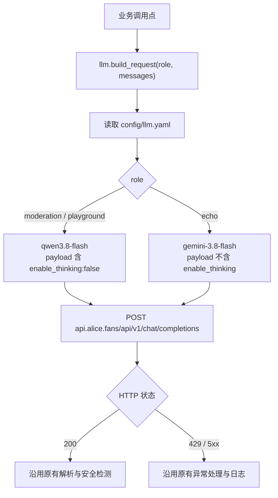
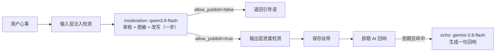

# PRD：大模型调用切换至米羊 Gateway

> 将 TiedStory 所有大模型调用从词元跳动（TokenDance）切换到米羊 Gateway，并把端点、模型、参数收敛到统一配置，不再散落在业务代码里。

---

## 一、需求概述

### 1.1 背景

当前 `main.py` 中有 7 处、`mcp_server.py` 中有 1 处各自硬编码了词元跳动的 URL、模型名 `qwen3.5-plus` 和 `enable_thinking: false`。切换供应商或换模型时要改 8 个位置，容易漏。

### 1.2 目标

1. 供应商切换为 **米羊 Gateway**（OpenAI 兼容）。
2. 按用途分配模型：

| 角色（role） | 模型 ID | 用途 |
|---|---|---|
| `moderation` | `aliyun_bailian_shanghai/qwen3.8-flash` | 树语：审核 + 改写（一次调用完成） |
| `echo` | `miyang/gemini-3.8-flash` | AI 自动回响 |
| `playground` | `aliyun_bailian_shanghai/qwen3.8-flash` | Playground 对话测试 |

3. 端点、模型、超时、思考开关统一放进 `config/llm.yaml`，代码只按角色取用。
4. 审核与改写仍为**一步**（沿用现有树语提示词，不拆分为两次调用），避免多一次延迟。

### 1.3 不做的事

- 不拆分「审核」和「改写」为两次调用（已评估：Gemini 改写在示例遵循度上不如 qwen3.8-flash，且多一次延迟）。
- 不改动提示词内容、输入层注入检测、输出层泄漏检测。
- 不改动前台 UI 的赞助署名（`TokenDance 点亮` 文案与链接），待产品决定后另行处理。

---

## 二、接口约定

| 项 | 值 |
|---|---|
| Base URL | `https://api.alice.fans/api/v1` |
| 对话接口 | `POST {base_url}/chat/completions` |
| 鉴权 | `Authorization: Bearer $MIYANG_API_KEY` |
| 环境变量 | `MIYANG_API_KEY`（取代 `TOKENDANCE_API_KEY`），存 `.env`，不进 git |
| 限速 | 每个 Key 默认 60 次/分钟，超出返回 429 |

### 2.1 参数差异

| 模型 | `enable_thinking` | 说明 |
|---|---|---|
| qwen3.8-flash | `false`（必须显式关闭） | 沿用 BUG-001 结论，关闭 Reasoning 避免超时 |
| gemini-3.8-flash | 不传 | 无需该参数；`max_tokens` 必须留足余量，见 2.3 |

### 2.2 已完成的连通性验证（2026-10-28）

- qwen3.8-flash 非流式：HTTP 200，约 1.1 秒
- qwen3.8-flash 流式：HTTP 200，首字约 1 秒，以 `data: [DONE]` 结束；末尾可能有 `choices` 为空的 usage 块，解析时需跳过（现有代码已处理）
- gemini-3.8-flash 非流式：HTTP 200，约 3–5 秒
- 树语提示词 4 类样本（正常 / 广告 / 危机 / 注入）下两个模型输出均为合法 `<response>` XML，拦截判断一致

### 2.3 Gemini 可靠性（联网测试中发现并修复）

| 现象 | 根因 | 处理 |
|---|---|---|
| `max_tokens=60` 时约 8%（2/25）的请求返回空内容，`finish_reason=length`，`completion_tokens=0` | Gemini 的**隐藏思考 token 也计入 `max_tokens`**，思考用掉约 56 个就耗尽 60 的额度 | `echo.max_tokens` 放宽到 512；字数仍由提示词约束并在代码里截断到 30 字。修复后 40/40 正常 |
| 偶发 `ReadTimeout`（>30 秒），此前样本最慢 11 秒 | 上游长尾延迟 | `echo.timeout` 放宽到 90 秒（后台任务无人等待） |
| 一次失败会让回响永久丢失 | 调度器在生成**之前**就把任务标记完成，兜底节点也一样 | `_generate_ai_echo` 对超时 / 5xx / 空内容最多尝试 2 次；仍失败则返回 `None` 并记录带 `finish_reason` 的日志 |

---

## 三、配置设计

### 3.1 `config/llm.yaml`

```yaml
gateway:
  base_url: https://api.alice.fans/api/v1
  api_key_env: MIYANG_API_KEY
  timeout: 30          # 非流式超时（秒）
  stream_timeout: 60   # 流式超时（秒）

models:
  moderation:
    id: aliyun_bailian_shanghai/qwen3.8-flash
    enable_thinking: false
  echo:
    id: miyang/gemini-3.8-flash
    max_tokens: 512      # 思考 token 计入额度，不能设小
    timeout: 90          # 角色级超时，优先于 gateway.timeout
  playground:
    id: aliyun_bailian_shanghai/qwen3.8-flash
    enable_thinking: false
```

角色可选字段：

| 字段 | 说明 |
|---|---|
| `id` | 必填，模型 ID |
| `enable_thinking` | 为 `false` 时请求体带 `"enable_thinking": false`；未配置则不发送 |
| `max_tokens` | 角色默认上限；调用时显式传入的值优先；未配置则不发送 |
| `timeout` | 角色级超时（秒），优先于 `gateway.timeout` / `stream_timeout` |

### 3.2 `llm.py` 模块

对外只暴露：

| 函数 | 作用 |
|---|---|
| `build_request(role, messages, *, stream=False, max_tokens=None, api_key=None)` | 返回 `(url, headers, payload)`；`api_key` 缺省读环境变量；`max_tokens` 缺省取角色配置 |
| `get_api_key()` | 读取 `MIYANG_API_KEY`，未配置返回 `None` |
| `get_api_key_env_name()` | 返回 Key 的环境变量名（用于错误提示） |
| `get_model_id(role)` | 返回角色对应的模型 ID（用于日志） |
| `get_timeout(stream=False, role=None)` | 返回超时秒数；传 `role` 时优先用角色级超时 |
| `reload_config()` | 清除配置缓存（测试用） |

角色不存在时抛 `KeyError`，配置文件缺失或格式错误时在启动阶段抛出，不静默回退。

---

## 四、调用点改造清单

| # | 位置 | 角色 | 方式 |
|---|---|---|---|
| 1 | `main.py` `/playground/api/chat` | `playground` | 流式；表单传入的 `api_key` 优先于环境变量 |
| 2 | `main.py` `_generate_ai_echo` | `echo` | 非流式；`max_tokens` / `timeout` 取角色配置；最多尝试 2 次（见 2.3） |
| 3 | `main.py` `/api/ribbon/analyze` | `moderation` | 非流式 |
| 4 | `main.py` `/api/ribbon/rewrite` | `moderation` | 流式 |
| 5 | `main.py` `/api/ribbon/process` | `moderation` | 非流式 |
| 6 | `main.py` `/api/ribbon/save`（保存前二次审核） | `moderation` | 非流式 |
| 7 | `main.py` `/open/api/ribbon` | `moderation` | 非流式 |
| 8 | `mcp_server.py` `create_ribbon` | `moderation` | 非流式 |

业务逻辑（注入检测、XML 解析、泄漏检测、限流）保持不变，仅替换「URL / headers / payload」的构造。

---

## 五、流程图





---

## 六、文件变更

| 文件 | 变更 |
|---|---|
| `config/llm.yaml` | 新增：网关与模型配置 |
| `llm.py` | 新增：配置加载与请求构造 |
| `main.py` | 7 处调用改用 `llm.build_request`；AI 回响增加重试；MCP 改为 `mcp_gateway` + 直接注册 `/mcp`、`/mcp/` |
| `mcp_server.py` | 1 处调用改用 `llm.build_request`；Server 改为按 lifespan 重建（见 6.1） |
| `templates/playground/ai.html` | 页头文案改为「米羊 · qwen3.8-flash」 |
| `tests/test_llm.py` | 新增：配置、请求构造、调用点、联网测试 |
| `tests/test_mcp.py` | 新增：MCP 协议、工具、生命周期测试 |
| `tests/test_open_api.py` | 环境变量名同步为 `MIYANG_API_KEY` |
| `.env`（本地与服务器，不入库） | 新增 `MIYANG_API_KEY`，移除 `TOKENDANCE_API_KEY` |
| `docs/FEATURES.md` / `docs/CHANGELOG.md` | 同步更新 |

### 6.1 附带修复：MCP 生命周期与 `/mcp` 路径

联调时发现上一版 MCP 接入存在两个缺陷，随本次一并修复：

1. **应用只能启动一次。** `StreamableHTTPSessionManager.run()` 每个实例只能调用一次，原先的模块级单例导致进程内第二次触发 lifespan（如 `TestClient`）即报错，原有 25 个 Open API 测试因此全部失败。现改为 `MCPGateway`：每次 lifespan 启动都新建 MCP server 与 session manager，关闭后置空；未就绪时返回 503。
2. **`/mcp` 会 307 重定向到 `/mcp/`。** 原先用 `mount("/mcp")` 挂载子应用所致，多数 MCP 客户端配置的是不带斜杠的地址。现直接注册 `/mcp` 与 `/mcp/` 两条路由，均直接返回 200。

---

## 七、上线注意

1. 服务器 `.env` 必须先写入 `MIYANG_API_KEY` 再重启，否则审核与回响全部失败。
2. 服务器 `requirements.txt` 已含 `pyyaml`，无需新增依赖。
3. Key 曾在聊天中明文出现，上线后建议到控制台轮换并同步更新两处 `.env`。
4. 前台页面「树语的声音，由 TokenDance 点亮」署名与新供应商不一致，需产品决定是否修改。
